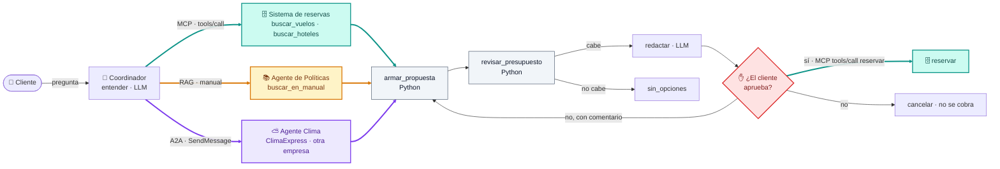

# ViajaFácil · Parte A: diseño

**Actividad ViajaFácil v2 · Arquitecturas multiagénticas**

ViajaFácil es una agencia de viajes ficticia. La solicitud de referencia es:

> *«Quiero ir a Cartagena 4 días en diciembre con mi pareja, presupuesto de 3
> millones. ¿Qué me recomiendas?»*

El diseño se implementa en
[`07c_ViajaFacil_Multiagente_Paralelo.ipynb`](./07c_ViajaFacil_Multiagente_Paralelo.ipynb).

## 1. Agentes

Solo es **agente** lo que razona con un LLM. Las demás piezas son herramientas
(funciones) o servicios.

| Agente | Qué hace | Qué NO hace |
|---|---|---|
| 🧭 **Coordinador** (el flujo de LangGraph + un LLM) | Entiende la solicitud y la convierte en datos validados (destino, mes, días, personas, presupuesto). Lanza las tres consultas a la vez, reúne los resultados y redacta la propuesta para el cliente | No suma precios, no inventa vuelos ni hoteles, no ve el medio de pago y **no reserva** sin la aprobación del cliente |
| 📚 **Agente de Políticas** | Busca en el manual (RAG) y responde citando el archivo de donde sale cada regla | No inventa reglas («El manual no tiene esa información»), no ve el presupuesto, el destino ni los datos del cliente |
| ⛅ **Agente Clima** (ClimaExpress, otra empresa) | Responde el clima esperado del destino en el mes del viaje | ViajaFácil no lo controla ni ve su código; no recibe presupuesto, nombres ni medio de pago |

Las piezas que **no** son agentes:

| Pieza | Tipo | Qué hace |
|---|---|---|
| 🗄️ Sistema de reservas | Servidor MCP | `buscar_vuelos`, `buscar_hoteles` y `reservar` |
| `armar_propuesta` | Herramienta (Python) | Combina vuelos y hoteles y elige la mejor opción que quepa |
| `revisar_presupuesto` | Herramienta (Python) | Recalcula el total y lo compara con el presupuesto |

## 2. Clasificación de las capacidades

| # | Capacidad | Es… | Justificación |
|---|---|---|---|
| 1 | Buscar vuelos y hoteles con sus precios | **MCP** | El sistema de reservas ya existe y lo usan varios sistemas: lo natural es que publique sus funciones como herramientas MCP, que cualquier agente descubre con `tools/list`. |
| 2 | Responder sobre políticas (manual de 50 páginas) | **RAG** dentro de un **agente** | Pasar 50 páginas al LLM en cada pregunta es caro e impreciso: se recuperan solo los fragmentos relevantes y el agente responde citándolos. |
| 3 | Armar la propuesta (vuelos + hotel + presupuesto) | **Herramienta** (Python) | Combinar opciones y elegir con una regla («el hotel de mayor categoría que quepa») es un cálculo; el LLM solo redacta el resultado. |
| 4 | Revisar que el total no supere el presupuesto | **Herramienta** (Python) | Una suma y una comparación: si la hiciera el LLM podría equivocarse con las cifras. |
| 5 | Hacer la reserva, solo si el cliente la aprueba | **MCP** + **humano en el bucle** | Es una herramienta más del sistema de reservas, pero el flujo solo llega a ella después de una pausa real (`interrupt()`) en la que decide el cliente. |
| 6 | Pedir el clima a un agente de otra empresa | **A2A** | Es un agente que no controlamos: lo encontramos por su Agent Card y le delegamos la pregunta con un mensaje A2A. |

## 3. Arquitectura: paralelo dentro de un flujo fijo

**Patrón elegido: paralelo** (abanico y reunión), dentro de un flujo
secuencial que termina con la aprobación humana.

Las consultas 1, 2 y 6 no dependen entre sí, así que se lanzan **a la vez** y
el flujo espera a las tres antes de armar la propuesta: el cliente espera lo que
tarda la consulta más lenta, no la suma de las tres. Después, los pasos son
siempre los mismos y en el mismo orden (proponer → revisar → aprobar →
reservar), por eso los fija el grafo.

¿Por qué no otro patrón?

| Patrón | Por qué no |
|---|---|
| Secuencial puro | Haría esperar las tres consultas una detrás de otra, sin necesidad |
| Router | Elige **un** camino, y esta pregunta necesita las tres fuentes |
| Supervisor | Un LLM decidiría en cada paso a quién llamar; gasta llamadas en algo que ya sabemos y puede saltarse pasos |
| Jerárquica | Demasiada estructura para tres especialistas |

## 4. ¿Qué ve cada agente?

| Dato | Lo ven | No lo ven |
|---|---|---|
| Pregunta completa del cliente | `entender` (Coordinador) | Políticas, Clima |
| Preguntas sobre políticas | Agente de Políticas | — |
| Destino y mes | Sistema de reservas, Agente Clima | Agente de Políticas |
| Personas y noches | Sistema de reservas, `armar_propuesta` | Agente Clima |
| **Presupuesto** | `armar_propuesta`, `revisar_presupuesto` y `redactar` | Políticas, Clima y el sistema de reservas |
| **Medio de pago** | Solo el nodo `reservar`, que lo envía al sistema de reservas | Ningún LLM ni el agente externo. La bitácora lo enmascara (`****`) |

**¿Por qué no todos deberían ver todo?**

- **Mínimo privilegio:** cada uno recibe solo lo que necesita para su tarea.
  Si un agente falla o lo manipulan (por ejemplo, con una inyección de prompt
  en un documento), no puede filtrar lo que nunca recibió.
- **Terceros:** ClimaExpress es otra empresa; enviarle el presupuesto o el
  nombre del cliente sería compartir datos personales sin necesidad.
- **Menos ruido y menos tokens:** un agente con menos contexto se confunde
  menos y cuesta menos.

## 5. Humano en el bucle

- **Dónde:** justo **después** de `revisar_presupuesto` y `redactar` (la
  propuesta ya tiene el total verificado) y **antes** de `tools/call
  reservar`. El nodo `aprobacion_humana` llama a `interrupt()`: el flujo se
  guarda en el checkpointer y espera; nadie puede reservar mientras tanto,
  porque `reservar` solo es alcanzable desde ese nodo.
- **Si aprueba:** se llama a `reservar` por MCP (el único paso que usa el medio
  de pago) y se confirma el código de reserva.
- **Si rechaza con un comentario** (por ejemplo, «algo más barato»): se descarta
  esa combinación y se arma otra propuesta **sin repetir las búsquedas**; si
  pidió algo más barato, el nuevo total debe ser menor. Hay un máximo de 3
  propuestas.
- **Si rechaza sin comentario:** el flujo termina sin reservar ni cobrar nada.

## 6. Diagrama

🟩 MCP · 🟧 RAG · 🟪 A2A · ⬜ Python · 🟥 humano en el bucle. La imagen está en
[`diagrama_arquitectura.png`](./diagrama_arquitectura.png). El notebook la
genera con `draw_mermaid_png()`, la misma función que dibuja los grafos de
LangGraph.

El grafo real que construye LangGraph a partir del código está en
[`grafo_flujo.png`](./grafo_flujo.png).
