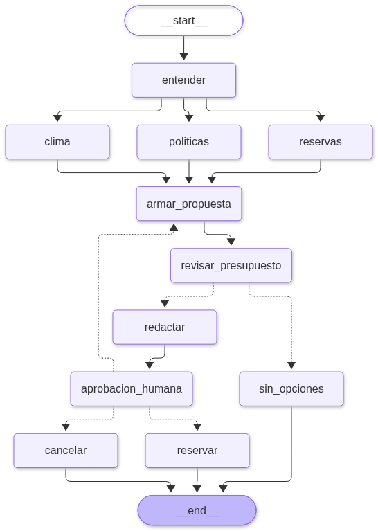

# ViajaFácil: asistente de viajes multiagente

Solución de la [Actividad ViajaFácil v2](./Actividad%20ViajaFácil%20v2%20·%20Diseño%20+%20programación%20·%20Arquitecturas%20multiagénticas.md)
(diseño + programación). ViajaFácil es una agencia de viajes ficticia que quiere
un asistente con IA para esta solicitud:

> *«Quiero ir a Cartagena 4 días en diciembre con mi pareja, presupuesto de 3
> millones. ¿Qué me recomiendas?»*

Todo es ficticio: vuelos, hoteles, políticas, clima y reservas. No se cobra
nada.

## Archivos

| Archivo | Qué es |
|---|---|
| [`Parte_A_Diseno.md`](./Parte_A_Diseno.md) | **Parte A**: agentes, clasificación de las capacidades 1 a 6, arquitectura, qué ve cada agente, humano en el bucle y diagrama con un color para MCP, A2A y RAG |
| [`diagrama_arquitectura.png`](./diagrama_arquitectura.png) | El diagrama de la Parte A, listo para la entrega (lo genera el notebook) |
| [`07c_ViajaFacil_Multiagente_Paralelo.ipynb`](./07c_ViajaFacil_Multiagente_Paralelo.ipynb) | Notebook resuelto con la arquitectura propia: flujo **en paralelo** con LangGraph, RAG, MCP y A2A simulados y aprobación humana con `interrupt()` |
| [`grafo_flujo.png`](./grafo_flujo.png) | El grafo real del notebook, dibujado con `draw_mermaid_png()` |
| [`Copy_of_07b_Reto_ViajaFacil_v2.ipynb`](./Copy_of_07b_Reto_ViajaFacil_v2.ipynb) | **Parte B** de la actividad: el notebook del reto con los **7 huecos completos** |
| [`requirements.txt`](./requirements.txt) | Dependencias del notebook `07c` |

## La arquitectura del notebook 07c



| Pieza | Viene de… |
|---|---|
| Datos de vuelos y hoteles, contador de llamadas al LLM | El notebook del reto |
| RAG: manual en Markdown, embeddings e `InMemoryVectorStore` | Laboratorio 6 (`06a`), versión original |
| Servidor MCP y agente A2A (aquí **simulados**, con las mismas operaciones: `tools/list`, `tools/call`, Agent Card, `SendMessage`) | Laboratorio 7 |
| `interrupt()`, `InMemorySaver` y `Command(resume=...)` | Laboratorio 2 |
| `draw_mermaid_png()` para el grafo y para el diagrama de la Parte A | Laboratorios 0 a 6 |
| Diagrama de secuencia en vivo en Gradio | Laboratorios 6 y 7 |

Decisiones principales:

- **Ningún LLM decide la ruta**: el grafo ya sabe que siempre hacen falta las
  tres fuentes. Los LLM solo interpretan la solicitud, consultan el manual,
  responden el clima (en la otra empresa) y redactan.
- **Las cifras las calcula Python**: `armar_propuesta` elige el hotel de mayor
  categoría que quepa y `revisar_presupuesto` recalcula el total por separado.
- **Mínimo privilegio**: el Agente Clima solo recibe destino y mes; el Agente
  de Políticas, solo las preguntas. El medio de pago solo lo usa el nodo
  `reservar`, nunca pasa por un LLM y la bitácora lo enmascara.
- **Si el cliente rechaza** con un comentario («algo más barato»), se arma otra
  propuesta sin repetir las búsquedas (máximo 3). Si rechaza sin comentario, el
  flujo termina sin reservar.

## Resultados (ejecución del 05-11-2026)

| Caso | Resultado |
|---|---|
| Pregunta principal | Aerolínea Brisa + Hotel Murallas (5★): $700.000 + $1.950.000 = **$2.650.000**, sobrante $350.000. El flujo se pausa con 0 reservas |
| El cliente aprueba | `VF-0001` confirmada, sin llamadas nuevas al LLM |
| Rechaza con «algo más barato» | Nueva propuesta: Aerolínea Brisa + Hotel Mar Azul, **$1.840.000**, por 1 llamada más (solo `redactar`) |
| Rechaza sin comentario | Se cancela; no se reserva ni se cobra |

El paso 11 del notebook hace 10 comprobaciones (las cifras, la revisión del
presupuesto, que haya consultas MCP, RAG y A2A, que se reserve solo tras
aprobar, que las citas existan en el manual y que el medio de pago no aparezca
en la bitácora).

### Llamadas al LLM (para la socialización)

| Sistema | Pregunta principal |
|---|---|
| Reto (`Copy_of_07b…`): un Coordinador LLM que decide a qué subagente llamar | **11** |
| Notebook 07c: flujo en paralelo (Coordinador 2 · Políticas 3 · Clima 2) | **7** |
| 07c con el Agente Clima como herramienta simple (reto opcional) | **5** |

Son conteos de una ejecución: varían un poco, porque los LLM deciden cuántas
búsquedas o herramientas usan. **¿Cómo reducirlas?** El clima es un dato: como
herramienta ahorra 2 llamadas. El Agente de Políticas podría ser una cadena RAG
fija (buscar y responder en 1 llamada). Y que el grafo fije la ruta ahorra las
llamadas que un Coordinador LLM gasta decidiendo a quién preguntar.

## Ejecutar el notebook 07c

### Entorno local

Desde la raíz del repositorio, con el entorno virtual activo:

```bash
python -m pip install -r laboratorio-7/ViajaFacil/requirements.txt
```

La clave va en el `.env` de la raíz (`GROQ_API_KEY=...`), como en los demás
laboratorios. Abre el notebook en VS Code, elige el kernel del entorno y ejecuta
las celdas en orden (pasos 0 a 13 y el reto). La primera vez, el paso 4
descarga el modelo de embeddings (~470 MB). Los pasos 2 y 7 necesitan internet:
`draw_mermaid_png()` dibuja con el servicio mermaid.ink. Sin conexión, imprimen
el texto Mermaid para pegarlo en <https://mermaid.live>.

En Gradio (paso 12): **Buscar propuesta** corre el flujo hasta la pausa;
**✅ Aprobar** y **❌ Rechazar** se activan solo cuando hay una propuesta
esperando. La interfaz muestra el diagrama de secuencia, el número de llamadas
al LLM por agente y el grafo. En local no crea enlace público.

> ℹ️ `draw_mermaid_png()` codifica el diagrama en base64 estándar y, si el
> resultado contiene `/`, mermaid.ink responde 404. El notebook lo envuelve en
> `dibujar_mermaid(...)`, que en ese caso repite la petición con base64 apto
> para URL.

### Google Colab

Sube el notebook, crea el Secret `GROQ_API_KEY` con acceso al notebook y
ejecuta en orden. El paso 4 crea la carpeta `manual/`, así que no hace falta
subir nada más.

## La copia del reto (Parte B)

Los 7 huecos completados:

| Hueco | Respuesta |
|---|---|
| 1 | `tools=[buscar_politica]` |
| 2 | Instrucciones del Agente de Clima: usar `consultar_clima` y responder breve con su dato |
| 3 | `tools=[consultar_clima]` |
| 4 | `agente_politicas()` |
| 5 | `agente_clima()` |
| 6 | `tools=[preguntar_a_reservas, preguntar_a_politicas, preguntar_a_clima, calcular_presupuesto]` |
| 7 | `respuesta_humana in ('si', 'sí')` |

La copia se dejó **sin salidas**: la entrega pide el enlace a tu copia en Colab
ejecutada, y está pensada para Colab (pide la decisión con `input()` y abre
Gradio con `share=True`). Se probó en local con Groq, respondiendo `si` de forma
automática: cumple las salidas esperadas de cada paso.

Groq rechaza a veces una llamada con `400 · tool call validation failed`
porque el modelo inventa el nombre de una herramienta (en una prueba pidió
`pedir_a_politicas`). Es intermitente: vuelve a ejecutar la celda. El
notebook 07c lo evita en el Agente de Políticas con `ModelRetryMiddleware`, como
el 06a.
